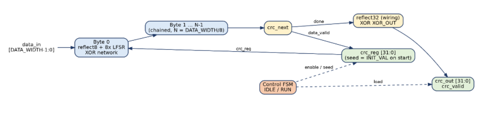
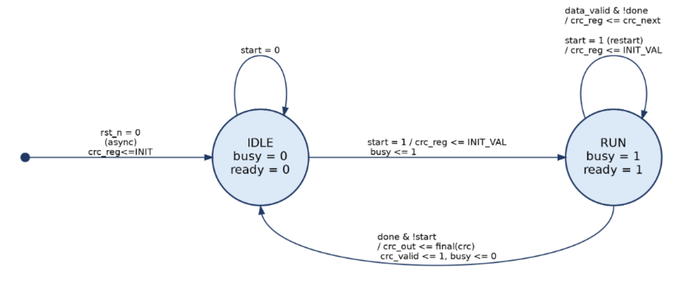
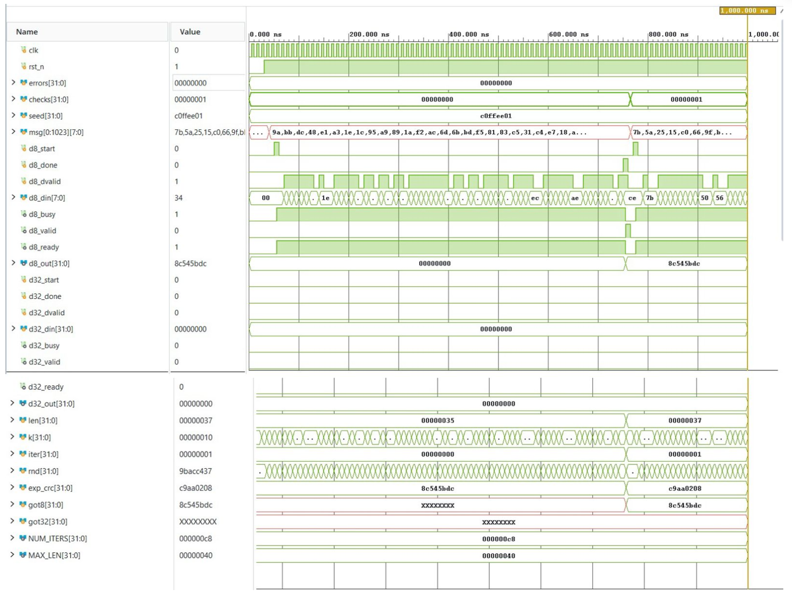
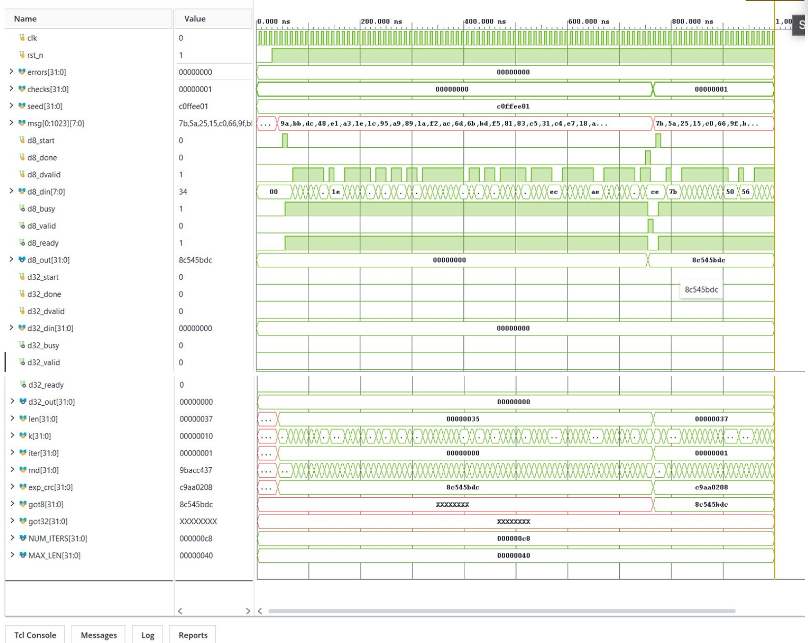
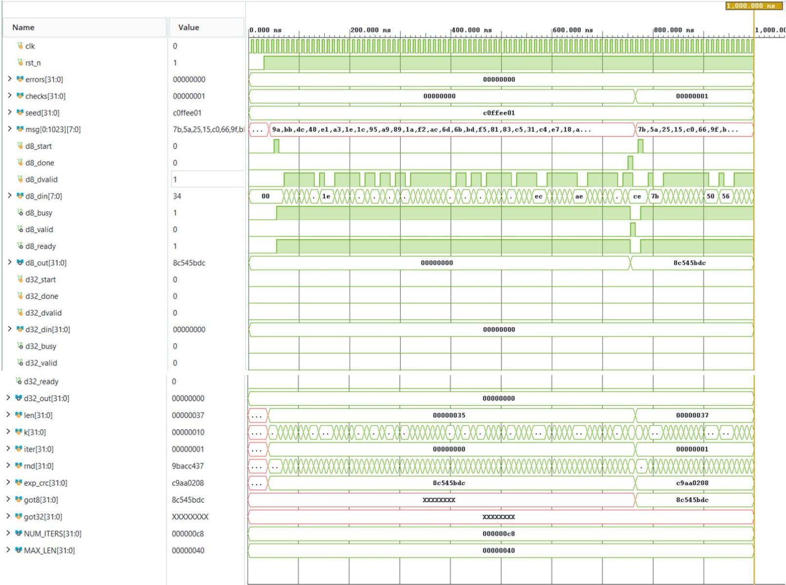
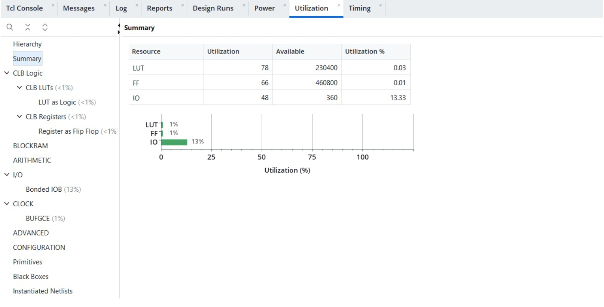
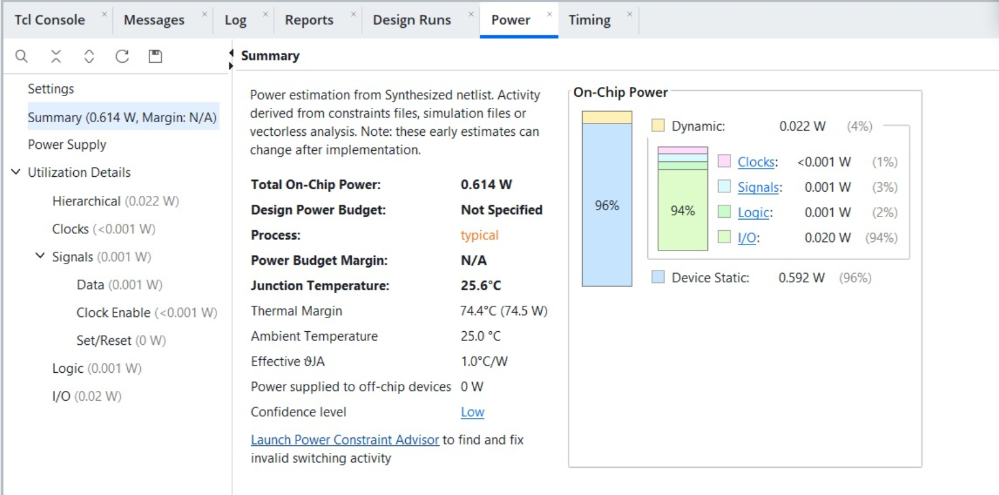

# CRC-32 Hardware Accelerator

## Overview
This repository contains a fully synthesizable, high-throughput streaming **CRC-32 Hardware Accelerator** written in Verilog HDL. The design uses an unrolled Galois/Fibonacci Linear Feedback Shift Register (LFSR) datapath to process up to 32 bits (4 bytes) per clock cycle alongside a lightweight two-state control FSM handling frame-level `start`/`done` handshake signaling.

The RTL is parameterizable across polynomials, initial seeds, final XOR masks, reflection logic, and datapath bus widths. It has been verified against an independent software reference model through 300 randomized regression checks and fully synthesized targeting a Xilinx Zynq UltraScale+ FPGA.

---

## Architectural Design & Methodology

### 1. Mathematical Polynomial & CRC Background
The default hardware instance implements the IEEE 802.3 / Ethernet / PNG standard generator polynomial over Galois Field GF(2):

> **G(x) = x^32 + x^26 + x^23 + x^22 + x^16 + x^12 + x^11 + x^10 + x^8 + x^7 + x^5 + x^4 + x^2 + x + 1**

* **Normal Generator Polynomial:** `0x04C11DB7`
* **Initial Seed (`INIT_VAL`):** `0xFFFFFFFF`
* **Final XOR Mask (`XOR_OUT`):** `0xFFFFFFFF`
* **Reflected Checksum Output Verification:** `CRC-32("123456789") = 0xCBF43926`

### 2. Architecture Block Diagram
The engine consists of three decoupled sub-blocks: an unrolled combinational byte-wise LFSR folding network, a 32-bit output finalization register, and a control FSM.

### 3. Parallel Unrolled LFSR Datapath
Instead of a traditional bit-serial shift register taking 8 cycles per byte, the shift and XOR operations are unrolled inside a combinational function (`crc32_byte`):

> **Throughput = DATA_WIDTH / 8 bytes per cycle**

During elaboration, constant polynomial folding maps the algorithm into a static, parallel XOR reduction tree, avoiding lookup tables (LUTs) or block RAMs (BRAM).

---

## Hardware Interface & Configuration

### Port Definitions
The streaming interface aligns with AXI4-Stream protocols where `done` functions as `TLAST`.

| Port | Direction | Width | Description |
| :--- | :--- | :--- | :--- |
| `clk` | Input | 1 | System clock; all sequential logic triggers on rising edge |
| `rst_n` | Input | 1 | Asynchronous active-low reset |
| `start` | Input | 1 | Pulse: loads seed and begins frame execution |
| `done` | Input | 1 | Marks the final data word of the current frame |
| `data_valid` | Input | 1 | Qualifies `data_in`; freezes internal state when low |
| `data_in` | Input | `DATA_WIDTH` | Input streaming word; byte 0 (`7:0`) processed first |
| `busy` | Output | 1 | High while a frame calculation is in progress |
| `ready` | Output | 1 | High while engine is in `RUN` state |
| `crc_valid` | Output | 1 | Single-cycle pulse asserting valid `crc_out` |
| `crc_out` | Output | 32 | Finalized registered CRC result |

### Module Parameters

| Parameter | Default | Description |
| :--- | :--- | :--- |
| `DATA_WIDTH` | `8` | Bus width in bits (multiple of 8); supports 8, 16, 32-bit streaming |
| `POLY` | `0x04C11DB7` | Generator polynomial (Normal MSB-first form); `0x1EDC6F41` for CRC-32C |
| `INIT_VAL` | `0xFFFFFFFF` | Seed loaded into accumulator on `start` pulse |
| `XOR_OUT` | `0xFFFFFFFF` | Final XOR mask applied to result |
| `REFIN` / `REFOUT` | `1` / `1` | Enable bit-reflection per input byte / 32-bit output |

---

## Control FSM & Handshake Logic

Control logic is governed by a minimalist 2-state FSM (`IDLE` and `RUN`).

| State | Condition | Next State / Action |
| :--- | :--- | :--- |
| `IDLE` | `start = 1` | Load `INIT_VAL` into `crc_reg`, assert `busy = 1`, transition to `RUN` |
| `IDLE` | `start = 0` | Hold IDLE; `crc_valid = 0` |
| `RUN` | `data_valid = 1, done = 0` | Fold current word: `crc_reg <= crc_next` |
| `RUN` | `data_valid = 1, done = 1` | Fold last word; assert `crc_valid = 1`, drive `crc_out`, transition to `IDLE` |
| `RUN` | `data_valid = 0, done = 1` | Flush frame: finalize `crc_reg`, assert `crc_valid = 1`, transition to `IDLE` |
| `RUN` | `start = 1` | Abort/Restart: Reload `INIT_VAL` immediately |

---

## Optimization Summary

| Technique | Implementation Details | Hardware Benefit |
| :--- | :--- | :--- |
| **Byte-Unrolling** | 8 LFSR steps evaluated combinationally per cycle | 8x throughput boost vs. bit-serial LFSR |
| **Logic Folding** | Polynomial XOR network synthesized into LUT tree | Zero BRAM/DSP usage; minimal slice area |
| **Wiring Reflection** | Wire swapping for `REFIN`/`REFOUT` at elaboration time | Zero LUT delay overhead for reflection |
| **Enable Mapping** | `data_valid` feeds direct flip-flop enable pins | Eliminates multiplexer LUT depth |
| **Output Buffering** | `crc_out` & `crc_valid` driven directly by FFs | Glitch-free, clean timing closure |

---

## Verification & Simulation Results

The design was verified using a randomized self-checking testbench (`tb_crc32_random_selfcheck.v`) driving 300 random test vectors against an independent software reference model.

### 1. Behavioral RTL Simulation
*Directed verification on string `"123456789"`, matching expected CRC-32 check value `0xCBF43926`.*

### 2. Post-Synthesis Functional Simulation
*Netlist simulation confirming logic preservation after Vivado synthesis.*

### 3. Post-Synthesis Timing Simulation
*Gate-level SDF back-annotated timing simulation at a 10 ns clock period (100 MHz).*

### Verification Summary

| Test Stage | Test Description | Total Checks | Result |
| :--- | :--- | :--- | :--- |
| **Directed Test** | ASCII `"123456789"` vs `0xCBF43926` | 1 | **PASS** |
| **Random 8-bit** | 200 random messages (1–64 bytes) with stream bubbles | 200 | **PASS** |
| **Random 32-bit** | Word-aligned streaming messages vs reference model | 50 | **PASS** |
| **Cross-DUT** | 32-bit DUT vs 8-bit DUT cross-verification | 50 | **PASS** |
| **Overall Regression**| **Behavioral, Post-Synthesis Functional & Timing** | **300** | **0 Failures** |

---

## Synthesis & FPGA Implementation

* **Target Device:** Xilinx Zynq UltraScale+ ZCU104 (`xczu7ev-ffvc1156-2-e`)
* **Synthesis Tool:** Xilinx Vivado 2026.1
* **Target Clock Constraint:** 10.0 ns (100 MHz)

### Resource Utilization (`DATA_WIDTH = 8`)

| Resource | Utilization | Available | Utilization % |
| :--- | :--- | :--- | :--- |
| **Slice LUTs** | **76** | 230,400 | 0.03% |
| **Slice Registers (FFs)** | **66** | 460,800 | 0.01% |
| **Block RAM (BRAM)** | **0** | 312 | 0.00% |
| **DSP Blocks** | **0** | 1,728 | 0.00% |
| **Bonded I/Os** | **48** | 360 | 13.33% |

### Timing & Power Performance

| Metric | Measured Value |
| :--- | :--- |
| **Worst Negative Slack (WNS)** | **+2.665 ns** (Setup clean) |
| **Max Clock Frequency (Fmax)** | **136.33 MHz** |
| **Peak Throughput (8-bit)** | **1,090.65 Mbps** (1.09 Gbps) |
| **Dynamic Power** | **0.022 W** (3.6%) |
| **Device Static Power** | **0.592 W** (96.4%) |
| **Total On-Chip Power** | **0.614 W** |

---
